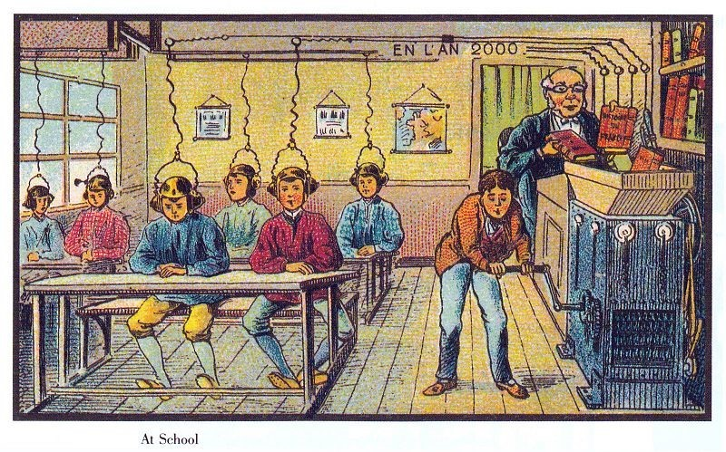

# The Crank Boy

A browser game after *À l'École* (At School), from the French *En l'an 2000* illustrations, attributed to Villemard, about 1910.

You turn the crank that powers the lesson. You are the only person in the room who is not wired in, and the only one who can see which books go into the machine. Crank steadily and the class receives the books clearly. Stop, and six heads lift. While the machine is silent you can read the page in the hopper, swap the book, pull a student's wire, or read aloud. At the bell the teacher grades every answer against his own copy.

**Play:** open [`play/v1.html`](play/v1.html) or [`play/v5.html`](play/v5.html), or the index page at `index.html`. Everything is plain HTML with no build step.

## Contents

| Path | What it is |
|---|---|
| `index.html` | Index: versions, the postcard, how to play, theory, how it was made, copyable prompts |
| `play/v1.html` | Version 1, Lesson One. The whole game in one file |
| `play/v5.html` | Version 5, The Class Book. The whole game in one file |
| `making/v5.html` | How version 5 was made: provenance, process, theory, copyable prompts |
| `docs/scion-game-studio-2.md` | The SCION Game Studio 2.0 instruction used for version 5 |
| `docs/multiplane-animation-studio.md` | The drawing-agent prompt used to restyle version 5 |
| `docs/theory.md` | The theory of play, written before any code |
| `docs/scion-ludic.md` | The SCION LUDIC studio instruction the game was made under |
| `docs/prompts.md` | Every prompt used, plus build prompts for versions 2 to 4 |
| `scion/case-01.html` | SCION Case 01: the research case on the same postcard, with a playable lesson from the pupil's seat |
| `scion/process.html` | Case 01 provenance, collaborators, process and copyable prompts |
| `scion/school-2000-engine.js`, `scion/playtest.js` | Case 01 game logic and its exhaustive playtest (`node scion/playtest.js`) |
| `docs/scion.md` | The SCION brief for Case 01 |
| `assets/` | The postcard |

## Versions

| | Name | Change | Status |
|---|---|---|---|
| 1 | Lesson One | You crank; the teacher feeds the books | Built |
| 2 | The Teacher Cranks | You choose the books; he decides whether they arrive | Not built |
| 3 | Two Seats | One player cranks, one wears the headset | Not built |
| 4 | The Pump | The climate-futures case: a hand pump on a shared pipe | Not built |
| 5 | The Class Book | You are a pupil: choose a helmet or the crank, then decide what the class's own book says | Built |

## Ledger

Documented: the postcard and its layout. Interpretation: that the machine turns books into a signal. Invented: the river Verse, Brécourt, Port-Ancel, every book and page, the wall map, the question, the students' names and answers.

SCION Case 01 reads the same card with Soyoun Jang's historicising method (with Jay David Bolter's tetrad work) and builds a second game from a pupil's seat. See [`scion/process.html`](scion/process.html).

Research context: Soyoun Jang, [Archive of Past Futures](https://soyjang.github.io/archive-of-past-futures/).

Made by Watson Hartsoe with Claude, in collaboration with Jay David Bolter and Collin Freeman, October 2026.
